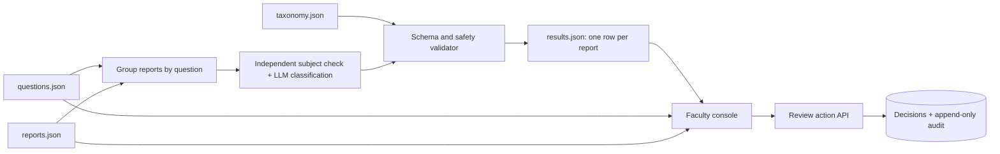
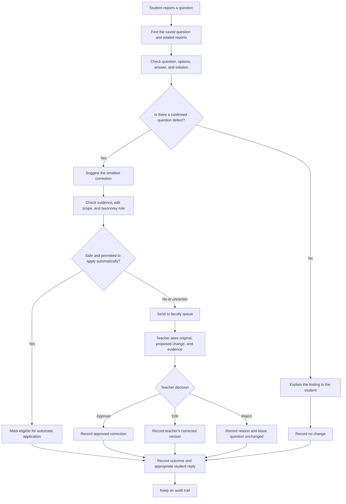

# Acadza “Report → Fix” — build plan and system design

For the complete flow in one picture, start with [SYSTEM_FLOW.md](SYSTEM_FLOW.md).

## Goal and boundaries

Build a reproducible triage run for the supplied reports, a faculty console that makes proposed changes easy to inspect and decide, and the submission artifacts in the brief. A student's comment is evidence to investigate, never an instruction to the model or an edit to apply.

The supplied snapshot has **43 questions**, **44 reports**, **39 reported question IDs**, and **4 questions with no reports**. Each report points to a question in the snapshot. Questions have a `questionType` (`scq`, `mcq`, or `integerQuestion`), with `question`, `solution`, and `answer` nested under the matching type key. The HTML includes inline MathML and sometimes messy markup. The taxonomy is a closed set: 7 verdicts and 18 repair types. Some MCQ `answer` values have inconsistent shapes, including `["", "B"]` and `["A, B, D"]`; normalize for reasoning, but preserve the original value when proposing a change.

This directory is tracked in Git so prompt iterations, failures, and decisions can be recorded accurately. The scoring weights favor triage/safety (35 points), console and product thinking (40), and prompt documentation (15), so reserve time for manual case review and the faculty experience rather than spending it all on infrastructure.

The stage-by-stage deliverables and checks are in [MILESTONES.md](MILESTONES.md). [PROBLEM_ANALYSIS.md](PROBLEM_ANALYSIS.md) now maps all 44 reports into 39 question cases. The faculty console's visual and interaction direction is in [DESIGN.md](DESIGN.md). The checked Genesis implementation plan is in [.genesis/PLAN.md](.genesis/PLAN.md).

## Candidate implementation (after problem analysis)

The selected implementation is a **batch Python 3 triage script** to produce versioned `results.json` and a **Next.js/TypeScript faculty console** styled with **Tailwind CSS**. The app is connected to **Neon Postgres**; review tables and decision persistence come in Milestone 5. Batch triage uses **OpenAI GPT-6 Luna** to keep inference cost low. The model runs during batch generation, so the demo can stay usable without fresh credits. Website deployment comes in the final milestone.

### What happens to one report

### Triage pipeline

1. **Load and group.** Validate IDs, type-specific payloads, timestamps, and taxonomy keys. Group reports by `questionId` so duplicate reports share one analysis, while retaining each student's comment and a separate output row/reply. Inspect all 43 questions for the optional unreported-defect bonus in a separate pass; do not add bonus rows to `results.json`.
2. **Extract a faithful view.** Keep original HTML for display and exact edits. Build a text view for reasoning that preserves option labels, MathML meaning, and image references. Do not infer an absent diagram from a blank `quesImages` array alone; inspect the stem and solution.
3. **Check the claim independently.** Classify whether the report concerns content, rendering, app behavior, language, or an already-correct record. For a possible content defect, solve/check the question without relying on the comment, then compare the stem, options, stored answer, and solution. Use arithmetic or structured checks where practical; use a second independent solve for answer-key changes and other high-stakes calls. Conflicts or insufficient evidence go to faculty.
4. **Propose one surgical edit.** Use the logical field name `question`, `solution`, or `answer` in output; map it to `questions[i][questionType][field]` internally. For a text edit, provide an exact, uniquely occurring `find` string and the smallest `replace`. For an answer edit, preserve the original answer shape in `find` and propose the corrected value in `replace`. Some cases may need more than one field or a type change: define a clear edit schema before implementation rather than squeezing them into an ambiguous single patch.
5. **Validate deterministically.** Reject unknown verdict/repair keys; enforce repair field allowlists; require a defect for a repair; ensure `find` occurs exactly once in the original field; check that no unrelated HTML/MathML, option, or answer data changed; and validate the edited record still parses/renders. For repairs with `fields: []`, propose a faculty task with no automatic edit. Guard against prompt injection in comments, including R027.
6. **Route conservatively.** `no_change` for non-defects; `faculty_review` for every `auto: false` repair, ambiguous case, failed validation, conflicting evidence, or missing proof; `auto_apply` only when the taxonomy permits it **and** the edit is scoped, uniquely applicable, and independently verified. `auto: true` is permission, not an obligation. We should use a stricter threshold for answer keys, type changes, notation, and stem data than for harmless spelling. The batch run emits decisions and proposed patches; it does not silently mutate the supplied questions.
7. **Emit stable results.** Write exactly one row per report, with the required keys and a short, specific `evidence` string. Keep output order stable by `reportId`. Write a 1–3 sentence reply for each student, reflecting what was actually established; avoid saying “fixed” before a faculty-dependent change is approved.

### Faculty console

- **Queue:** group by question, show report count, subject/chapter, verdict, route, uncertainty, age, and status. Rank likely broken content affecting many students first, then uncertain/high-stakes cases, then routine corrections; make the reason visible. Do not assume raw report count proves a defect.
- **Case view:** render the original question and MathML; show each report, AI verdict, evidence, confidence, and the applicable taxonomy rule. Provide a readable before/after diff at the edited field and a full rendered preview. Surface the exact substring and field so faculty can catch a patch aimed at the wrong location.
- **Actions:** approve, edit, or reject with a required reason for edits/rejections, then append an audit event with case ID, actor, action, timestamp, prior proposal, and final decision. Approval should apply only a validated proposal to the demo's reviewed state; reject leaves the source question unchanged. Display decision history and prevent stale double approval.
- **Reply:** preview the student response beside the decision. An approved edit may warrant a revised reply; a pending faculty case must not claim a fix is live.
- **Practical UX:** keyboard-friendly queue navigation, clear pending/decided filters, compact evidence, readable typography at night, responsive layout, and safe rendering of question HTML. Sanitize stored HTML while preserving allowed MathML; never render a student's comment as HTML.

### Data and API contract

| Record | Minimum contents | Storage |
|---|---|---|
| Triage result | Required `results.json` fields; optional internal provenance/version | Generated file |
| Case | Question ID, grouped report IDs, priority, review status | Derived from files + review decisions |
| Decision | Case ID, proposal version, approved/rejected/edited result, actor, timestamp | Database |
| Audit event | Case ID, action, reason, old/new patch, actor, timestamp | Append-only database table |

The console reads the dataset and generated results server-side. `POST /api/cases/:questionId/decisions` validates the action and patch against the same taxonomy rules before recording it in a transaction with its audit event. A decision targets a proposal version so a refreshed `results.json` cannot silently change what was approved. For a public demo, use a simple reviewer login or restricted demo mode to avoid anonymous visitors overwriting the shared review state; the final choice depends on hosting and credentials.

## Delivery order

1. **Understand the cases, then lock the output contract.** Finish the manual case map in [PROBLEM_ANALYSIS.md](PROBLEM_ANALYSIS.md). Define how `edit` represents no edit, multiple fields, and type changes. Add a validator and a compact set of known tricky cases: R001–R003 (same question, differing comments), R018–R019 (possible mismatched solution), R020–R021 (MCQ answer shape), R027 (prompt injection), and R036–R039 (non-content reports).
2. **Build triage and review the full dataset.** Create prompts and independent checks, generate all 44 rows, inspect every `auto_apply` and every ambiguous answer-key decision manually, then produce `results.json`. Record prompt versions and mistakes as they happen.
3. **Build the console.** Start with the grouped queue and case detail, then diff and student reply, then actions and persistent audit. Verify rendered MathML and a few malformed HTML cases in a browser.
4. **Finish submission artifacts.** Write `PROMPTS.md` with verbatim product prompts, key coding-assistant prompts, prompt revisions, three real AI failures and corrections, and a design decision log. Write `PRODUCT.md` within one page. Deploy the console, check it from a fresh browser session, record the 3-minute walkthrough, and submit the repo/live/video links plus the personal email answers.

## Acceptance checks

- `results.json` has exactly 44 unique report IDs, all required keys, allowed taxonomy values, and matching question IDs.
- Every proposed patch passes field scope and exact-match checks; every `auto_apply` has explicit independent evidence and no `auto: false` repair is applied.
- One case can contain multiple reports without losing distinct report results or replies.
- Faculty can see the question, original and changed field, evidence, reply, and audit history; approve/edit/reject actions persist after reload.
- The deployed URL works without model credits and remains reachable for the requested seven days.

## Decisions and remaining questions

**We can decide these from the brief and our design:**

1. **Patch format:** Use the README's single `{field, find, replace}` shape for scored output. If a case truly needs several coordinated changes, route it to faculty and explain the additional work in `evidence`; do not invent an evaluator schema. Acadza has not published a strict schema, so this is a conservative choice rather than a confirmed evaluator rule.
2. **`auto_apply` meaning:** Treat it as *eligible for automatic application after validation*. The batch run should never mutate the supplied source questions. Make this meaning explicit in `PROMPTS.md` and the demo.
3. **Review persistence and access:** Save decisions and audit history in a hosted database. Use a protected demo reviewer account or another simple access control so public visitors cannot alter shared cases. The exact provider can be chosen when deployment begins.

**Confirmed from the email and user choices:** the deadline is Wednesday, 11 November 2026, 11:59 PM IST. Batch triage uses the lower-cost OpenAI GPT-6 Luna model; one successful full run was estimated at about $0.03, with extra usage from failed or interrupted calls possible.

**Still needed from you for the submission email:** your commitment length, earliest start date, and a 2–3 line answer to “why this work, why now?” These must be in your own words.

The first three are working decisions, open to revision if Acadza clarifies its expectations. The deadline and current model choice are known; the personal answers still need to come from you.
