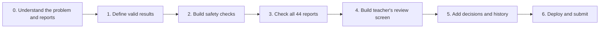
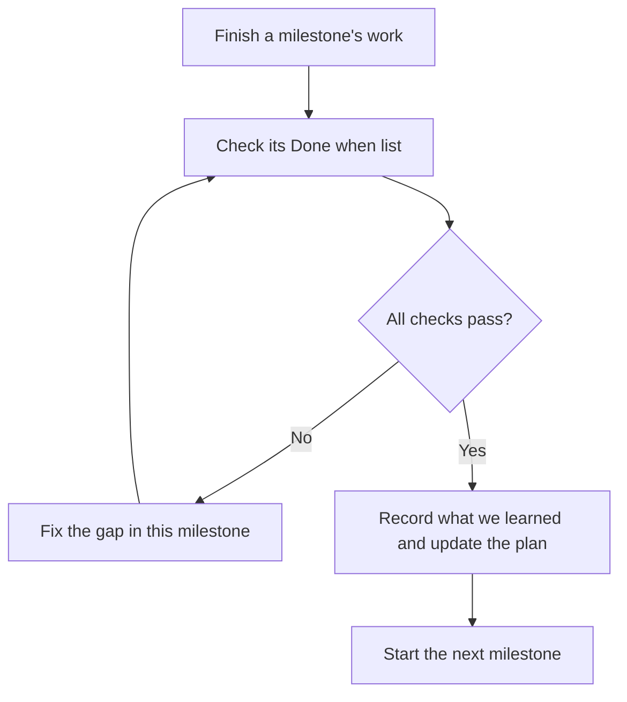

# Project milestones

We will finish and check one milestone before starting the next. Start with the single diagram in [SYSTEM_FLOW.md](SYSTEM_FLOW.md); [ASSIGNMENT_PLAN.md](ASSIGNMENT_PLAN.md) has the detailed system design, and [README.md](README.md) is the original assignment brief.

## Milestone 0 — Understand the problem and reports

**Goal:** Say clearly what problem Acadza has, what a good outcome looks like, and what the supplied reports are actually about.

**What we produce:** The architecture diagram, these milestones, a list of open decisions, and a case map of all 44 reports grouped into 39 questions. We inspect representative cases by hand. See [PROBLEM_ANALYSIS.md](PROBLEM_ANALYSIS.md).

**Done when:** We can explain the full system in plain words, locate every report's question, and show examples where a student is right, partly right, or misleading. **No product code is part of this milestone.**

## Milestone 1 — Define valid results

**Goal:** Decide what a valid decision for one report must contain before generating 44 of them.

**What we produce:** A checked link between reports and questions, a clear `results.json` format, and validation for IDs and taxonomy keys. Duplicate reports still get separate result rows.

**Done when:** Every supplied report links to one question, and invalid or incomplete result rows fail the contract check.

## Milestone 2 — Build safety checks

**Goal:** Prevent an AI suggestion from changing the wrong field or following a student's instruction.

**What we produce:** Rules that reject forbidden repair types, edits outside allowed fields, missing evidence, and unsafe exact-text changes. R027 is a test case for ignoring instructions hidden in a report.

**Done when:** An unsafe or uncertain suggestion is sent to faculty; it can never be marked for automatic application.

## Milestone 3 — Check all 44 reports

**Goal:** Produce and check the file Acadza will score.

**What we produce:** A repeatable checker that reads each case, suggests a verdict and small correction, and drafts a student reply. We manually review all 44 results, especially answer-key changes and every `auto_apply` route. We record prompts and revisions as we work.

**Done when:** `results.json` has 44 valid, evidence-backed rows; no prohibited automatic change; and no reply falsely says an unapproved fix is live.

## Milestone 4 — Build the teacher's review screen

**Goal:** Make the AI's work quick for a busy teacher to inspect.

**What we produce:** A website with a question-based queue. A teacher can open a case, read the question and student reports, see the suggested verdict and evidence, compare before and after, and preview the student reply. The question's maths must display properly.

**Done when:** A teacher can find a high-priority case, understand the proposed change, and spot a suspicious suggestion without opening the raw JSON files. The screen works on a laptop and a phone.

## Milestone 5 — Add teacher decisions and history

**Goal:** Let a teacher finish a case and see what happened later.

**What we produce:** Approve, edit, and reject actions with a saved reason where needed. Each action records who did it, when, what was proposed, and what was decided. Refreshing the page does not lose the history.

**Done when:** All three actions work on real cases, a rejected case leaves the question unchanged, and the saved history matches the action taken. The site does not let an old approval silently apply a newer AI suggestion.

## Milestone 6 — Deploy and submit

**Goal:** Deliver the complete assignment in the form Acadza requested.

**What we produce:** A public GitHub repo with code and `results.json`, a live website that works without fresh AI credits, `PROMPTS.md`, a one-page `PRODUCT.md`, and a 3-minute screen recording. The submission email includes the three links and the requested personal answers.

**Done when:** A fresh visitor can open the website, follow the demo, and inspect the repository; the live URL remains available for seven days; and every required deliverable is present.

## How we move between milestones

Milestone 0 has produced the architecture diagram and a claim map for all 44 reports. The next implementation slice is Milestone 1, after the checked Genesis plan is reviewed. Detailed case verification continues in Milestone 3.
