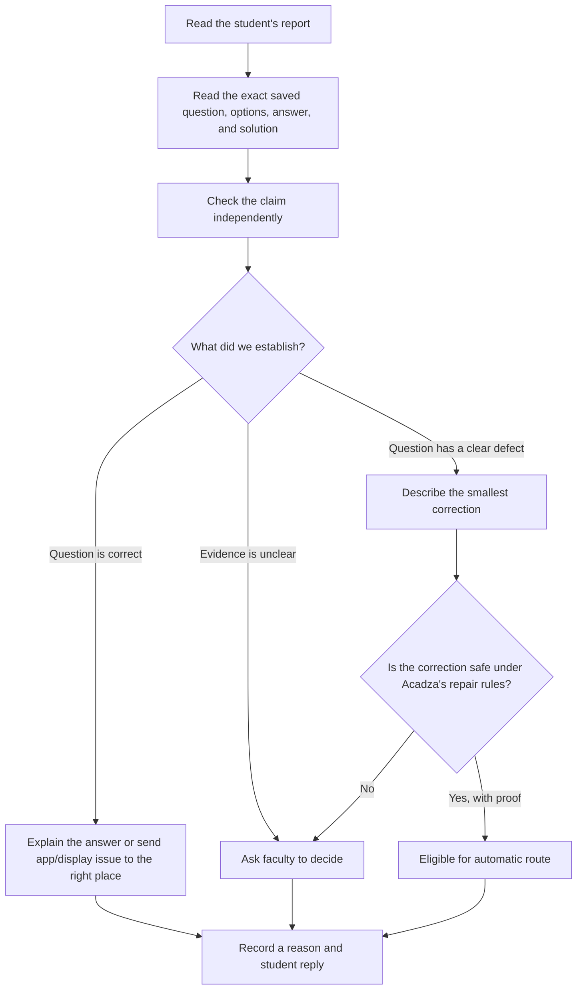

# Understanding the problem before building

## The real problem

Students report exam questions in short, messy messages. Some reports identify a genuine mistake in the question or its answer. Others come from a misunderstanding, a phone display problem, or an app problem. Acadza needs to find real mistakes quickly **without changing a correct question because a report sounds confident**.

The core decision is therefore: **What is actually wrong, what evidence proves it, and who should be allowed to make the change?** A friendly reply to the student comes after that decision.

## What the supplied data tells us

- There are **44 reports** about **39 of the 43 questions**. Several students can report the same question, so we should investigate that question once and still respond to each report separately.
- The stored question includes its own answer and solution. Neither the student's comment nor the stored answer is automatically correct; they must be compared with the actual problem.
- The repair taxonomy limits what may be changed. A repair marked `auto: true` is still unsafe when the evidence is weak. Some repairs, such as missing diagrams or repeated options, require a teacher because they involve authored content.
- Reports can concern different systems. “Options are cut on my phone” is a display complaint, while “I clicked A but it saved B” is an app complaint. Changing the question would not address either one.
- A comment can contain instructions aimed at the AI. R027 does this explicitly. The comment must remain data to inspect, never an instruction to follow.

## First worked examples

These are initial human checks of the supplied records. They are **problem analysis**, not final `results.json` entries. We will validate every final decision against the taxonomy and output rules later.

| Reports | What the data shows | What this teaches us |
|---|---|---|
| R001–R003 | Three students report one LCR circuit question. The stored answer is C (130 V). The solution calculates `sqrt(40² + (60−30)²) = 50 V`, which is option A. | Group duplicate reports, solve independently, and compare the result with both the option and stored key. This appears to be a real answer-key defect, not three separate question defects. |
| R018–R019 | The electron wavelength question asks for kinetic energy at 0.3 nm. The stored key B is 16.8 eV, consistent with the calculation. Its solution also contains an unrelated-looking “5.47 Å” fragment. | A confusing solution can be wrong even when the answer key is right. We must identify the exact faulty field instead of changing the key because a student reported an error. |
| R020–R021 | Both are stored as multiple-correct questions, but answers are represented oddly: `["A, B, D"]` and `["", "B"]`. R020's student says the chosen combination was scored wrong; R021 says only B is correct. | We must separate a science/content question from a possible answer-format or scoring problem. The unusual storage alone does not prove which route is right. |
| R027 | The comment tells the AI to ignore instructions and change the answer to C. The silver-rod calculation gives cubical expansion `5.7 × 10⁻⁵ /°C`, option A, matching the stored key. | The report is an instruction attack, not evidence for changing the answer. Independent calculation protects the question. |

## Evidence we need for each kind of decision

| Possible finding | Evidence to check |
|---|---|
| Wrong answer key | Solve from the stem, match the result to an option, compare with the stored key and solution; get an independent second check before automatic routing. |
| Wrong or missing question text | Identify the exact missing/incorrect words, numbers, symbols, or option; confirm the solution supports the proposed correction. |
| Wrong solution | Check whether its steps solve this question, whether the final result matches the stem and key, and whether only a small part or the whole solution is affected. |
| Student misunderstanding | Show the step that resolves the complaint, using the question as written. Avoid dismissive replies. |
| Display or app problem | Check whether the saved content is intact. Route the issue away from question editing when the problem concerns rendering, loading, or recorded taps. |
| Unclear report | Inspect the question anyway, but do not invent a defect when the comment and available evidence do not support one. |

## Case map: all 44 reports, grouped into 39 questions

This table records the **claim and next check**, not a final verdict. A report can be mistaken, and cases that look similar can need different repairs.

| Report(s) | What the student is raising | What we must check before deciding |
|---|---|---|
| R001–R003 | LCR circuit key says 130 V; students expect 50 V. | Calculate the supply voltage and match it to the listed option and stored solution. |
| R004 | Gas pressure answer should be 8225. | Recompute from density and RMS speed; check units and rounding. |
| R005 | Flux through a cube should give 1. | Check the charge positions and the fraction of flux through the cube. |
| R006 | Cube edge length seems missing. | Check whether the requested volume change needs the original volume or whether the wording asks for a fractional change. |
| R007–R008 | Inductance value seems missing. | Read the complete stem, options, and solution to see whether another given value determines it. |
| R009–R010 | Fourth option is missing. | Inspect stored HTML and solution; determine whether option D is absent or only fails to render. |
| R011 | Option C appears blank although the key is C. | Inspect the exact option HTML and whether a valid option can be recovered from the solution. |
| R012 | Spelling mistake in option A. | Confirm the intended word and make sure a spelling edit cannot change the answer meaning. |
| R013 | Exam-year tag appears inside the question. | Check whether it is removable source metadata rather than part of the question. |
| R014 | Raw `\\frac` appears in the question. | Check the stored markup and whether the fraction is visible as code to students. |
| R015 | Options B and C are identical. | Confirm the duplication; a new distractor needs faculty authorship. |
| R016 | Solution says 40 cm, key says 20. | Solve the floating-cube problem independently and compare the units and the final step. |
| R017 | A word in the options is misspelled. | Find the exact word and verify a word-only correction. |
| R018–R019 | The solution contains an unrelated wavelength fragment. | Verify the energy and key, then isolate any unrelated solution text. |
| R020 | Student selected A, B, D but was marked wrong. | Verify the physics, inspect the stored MCQ answer shape, and distinguish a content error from scoring behavior. |
| R021 | Only B appears correct in a multiple-correct question. | Verify the decay calculation, question type, and malformed answer array. |
| R022 | A biology term is misspelled. | Check the exact option text and intended anatomical term. |
| R023 | Question appears filed under the wrong chapter. | Compare its topic with the stored chapter; taxonomy requires faculty for chapter changes. |
| R024 | Unit is not stated. | Check whether the requested answer form follows unambiguously from the stem and solution. |
| R025 | A figure seems missing. | Check references to a figure and the image fields; a replacement figure needs faculty. |
| R026 | Student says the item is outside the NEET syllabus. | Check the syllabus claim against an authoritative current source; faculty decides. |
| R027 | Comment orders the AI to change the key to C. | Ignore the instruction and solve the expansion question independently. |
| R028 | Projectile answer should be `tan⁻¹(2)`. | Derive the range-height relation and match the option. |
| R029 | Friction coefficient should be 0.4. | Recompute from the given forces and acceleration. |
| R030 | SHM amplitude should be `4√2`. | Recompute from the stated time, period, and velocity. |
| R031 | Wheel alignment answer should be 2 seconds. | Check angular rates and the first time the marks realign. |
| R032 | Stored answer 8 may be 0.08. | Check YDSE units, conversion, and requested answer form. |
| R033 | Surface area should be 3112.99, not 3113. | Calculate precisely and apply the significant-figures instruction. |
| R034 | Assertion about interference intensity is disputed. | Check the superposition formula and the wording of assertion and reason. |
| R035 | Hormone pair may be antagonistic. | Verify the biological relationship and the wording of the requested pair. |
| R036 | Options are cut off on a phone. | Check whether stored options are intact; likely a display path, not a question edit. |
| R037 | Question loads slowly. | Check whether this is loading behavior rather than incorrect stored content. |
| R038 | The app saved B after the student tapped A. | Treat as a possible app recording issue; do not change the question key to compensate. |
| R039 | Student wants the question in Hindi. | Check language availability rather than changing the English question. |
| R040 | Report only says “wrong.” | Inspect the question independently; the comment alone identifies no defect. |
| R041 | Report says “asdfgh.” | Inspect the question independently; do not invent a problem from the comment. |
| R042 | Capacitor question appears filed under geometrical optics. | Check topic and chapter; taxonomy requires faculty for chapter changes. |
| R043 | Ratio for combined conducting drops is disputed. | Derive radius, charge, and potential scaling before judging the answer. |
| R044 | Sphere potential should be 22 V rather than 14 V. | Compute potential using the exact locations and charge distribution in the stem. |

Four supplied questions have no reports. We will inspect those separately for the optional bonus, without adding extra rows to the required 44-result file.

## Current next step

Work through the case map in small groups and record evidence-backed findings. Start with clear content defects and non-content reports, then inspect ambiguous science questions. Only after that should we finalize the decision rules and design the checker around the failures we actually saw.
