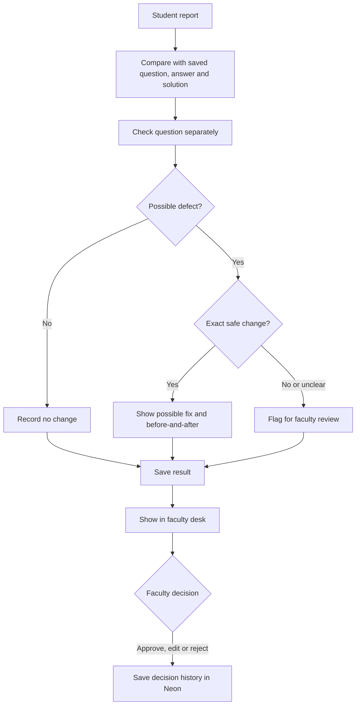

# Acadza Report Desk

JEE and NEET students bear the biggest cost of a wrong question: it can waste study time and teach a false answer. One defect may mislead many students. Faculty also lose time sorting vague reports from real problems.

The Report Desk puts each report beside the saved question, answer, and solution. It shows an exact before-and-after when the evidence supports a possible fix. Unclear cases go to faculty with a reason.

AI must never change a question by itself: one wrong automatic edit could spread a new error to every student. It cannot invent missing options or content, guess when answers do not fit, decide syllabus coverage, or treat a student's comment as proof. This demo saves faculty decisions in Neon; the supplied question files stay unchanged.

In week one, track **the share of reported problems faculty confirm are real**. This shows whether the desk finds useful signals without creating too much noise.

Beyond the brief, alert the content team when several reports point to the same question, so they can prioritize issues affecting many students.
