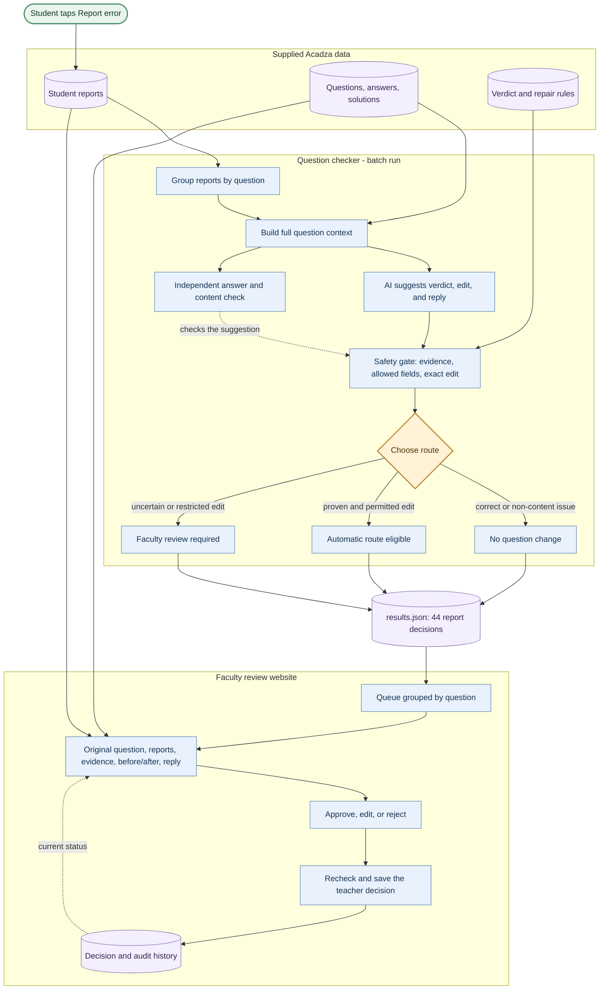

# Acadza Report → Fix architecture

This diagram shows the **parts of the system and how information moves between them**, like the architecture example you shared. Read it from the student report at the top through triage, the scored output, and the teacher's review website.

**What each part does:** The checker looks at the report and the original question. The independent check and safety gate challenge its suggestion. The route tells us whether to leave the question alone, mark a safe correction as eligible, or ask faculty. `results.json` stores one decision per report. The website presents those decisions by question, and faculty actions go into the audit history.

**Important boundary:** The batch run produces proposed decisions. It does not change Acadza's live question bank. A student's comment is input data, never an instruction to the checker.

See [MILESTONES.md](MILESTONES.md) for when we build each part and [PROBLEM_ANALYSIS.md](PROBLEM_ANALYSIS.md) for examples from the supplied reports.
